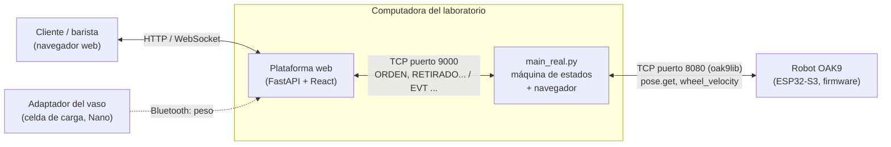

# RoboCoffe · Software del robot OAK9

Este folder contiene todo lo que mueve al robot. Su trabajo es recibir una orden ("lleva este café a la mesa 2"), ir a la mesa, esperar a que el cliente tome el vaso y regresar a la base. Además avisa por la red de cada paso que da.

**Equipo de la plataforma web:** su punto de partida es [`docs/01_guia_equipo_web.md`](docs/01_guia_equipo_web.md). Ahí está lo que tienen que hacer y lo que ya está resuelto. Pueden desarrollar sin el robot con el **robot simulado**.

> Estado al 12 nov 2026. Lo que está probado y lo que falta está en [`docs/09_pendientes_y_contradicciones.md`](docs/09_pendientes_y_contradicciones.md).

## Cómo encaja todo



- **Robot OAK9:** el firmware solo sabe medir su pose (encoders y giroscopio) y mover las ruedas. No decide nada.
- **`main_real.py`:** corre en una computadora. Es el cerebro del robot: la máquina de estados decide qué hacer y el navegador cierra el lazo de movimiento 20 veces por segundo.
- **Plataforma web:** le habla a `main_real.py` con mensajes de texto de una línea por TCP en el puerto 9000. **Esa línea es la frontera entre los dos equipos.** El contrato completo está en [`docs/02_protocolo.md`](docs/02_protocolo.md).

## Arranque rápido (5 minutos, sin robot)

Requisito: Python 3.10 o más reciente. El núcleo no necesita paquetes extra (ver `requirements.txt`).

```bash
# Terminal 1: robot simulado (misma máquina de estados y mismo protocolo que el real)
python servidor_simulado.py

# Terminal 2: mandarle órdenes a mano y ver qué responde
python consola_ordenes.py
oak9> MESA2
```

Para ver el cliente de Python haciendo tres pedidos completos (entregado, no retirado y cancelado):

```bash
python servidor_simulado.py --rapido 10 --entrega 60     # terminal 1
python cliente/demo_seguimiento.py                        # terminal 2
```

## Qué hay en cada archivo

| Archivo o carpeta | Para qué sirve | Quién lo usa |
|---|---|---|
| `main_real.py` | Corre la máquina de estados con el OAK9 real y escucha órdenes en el puerto 9000 | Operación |
| `servidor_simulado.py` | Igual que `main_real.py`, pero con un robot simulado. Permite provocar fallas desde la terminal | **Equipo web** |
| `cliente/robocoffe_cliente.py` | Cliente asyncio listo para FastAPI. Se encarga de la conexión, los ids, los reintentos y el seguimiento de cada pedido | **Equipo web** |
| `cliente/ejemplo_fastapi.py` | Backend de ejemplo: endpoints de pedidos y robot, más un WebSocket | **Equipo web** |
| `cliente/demo_seguimiento.py` | Prueba del cliente sin FastAPI | **Equipo web** |
| `consola_ordenes.py` | Consola para teclear `MESA1`, `PAUSA`… y ver la telemetría | Todos |
| `enviar_orden.py` | Manda una sola orden y sigue la telemetría hasta que el robot vuelve | Todos |
| `registro_pruebas.py` | Registro de pruebas que genera las hojas «Pedidos» y «Robot» del dashboard | Ing. Industrial |
| `probar_movimiento.py` | Prueba solo el movimiento (sin máquina de estados) y guarda un CSV | Calibración |
| `main_sim.py` | Demostración rápida, sin red: tres mesas, un obstáculo y una cancelación | Curso |
| `robocoffe_fsm/` | El paquete: máquina de estados, protocolo, rutas, navegador y adaptadores | — |
| `tests/` | 28 pruebas: una por transición y por regla del protocolo, más la que revisa la copia de Webots | — |
| `real/` | Calibración de bajo nivel: odometría y zona muerta | Calibración |
| `sincronizar_webots.py` | Copia el paquete al controlador de Webots después de un cambio | Quien cambie el paquete |
| `webots/` | Mundos, PROTOs y controlador de Webots: entregas a 3 mesas con la misma máquina | Simulación |
| `docs/` | Documentación (índice abajo) | — |

## Documentación

1. [Guía para el equipo web](docs/01_guia_equipo_web.md): qué les toca, flujo de un pedido, checklist de integración.
2. [Protocolo TCP](docs/02_protocolo.md): el contrato, con cada mensaje, error y evento.
3. [Máquina de estados](docs/03_maquina_estados.md): los 9 estados, las transiciones T1–T17 y los parámetros.
4. [Movimiento y calibración](docs/04_movimiento.md): por qué no usamos go2point, el navegador de lazo cerrado y los resultados.
5. [Robot real paso a paso](docs/05_robot_real_paso_a_paso.md): red, arranque, primera prueba y orden.
6. [Simulación](docs/06_simulacion.md): el robot simulado por TCP y Webots.
7. [Datos para el dashboard](docs/07_datos_dashboard.md): columnas y qué evento llena cada una.
8. [Problemas comunes](docs/08_problemas_comunes.md): timeouts, WiFi, puertos, firewall.
9. [Pendientes y contradicciones](docs/09_pendientes_y_contradicciones.md): datos `<POR MEDIR>`, decisiones `<RELLENAR>` y límites conocidos.

## Pruebas

```bash
python -m pytest -q tests          # o, sin pytest: python tests/correr_pruebas.py
```

## Convenciones

- **Marco de referencia:** origen en la base; x al frente, y a la izquierda; θ en grados, antihorario positivo. La pose es la de o1, el centro entre las ruedas.
- **Valores pendientes:** `<POR MEDIR>` es un dato que sale de una prueba o una medición; `<RELLENAR>` es una decisión del equipo. No se inventan datos.
- **Cada rama del código marcada `# Tn`** corresponde al renglón Tn de la tabla de transiciones.
