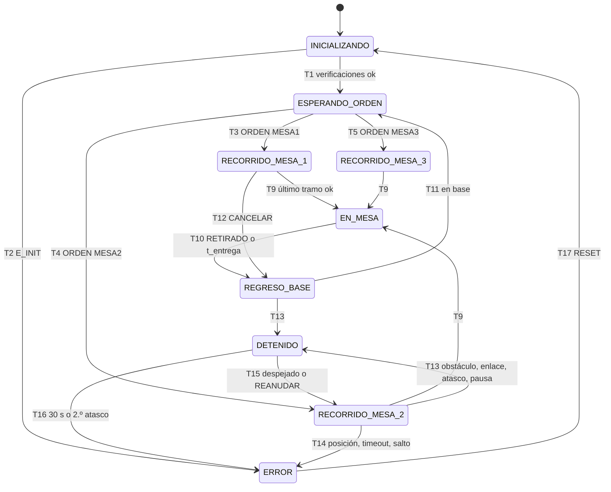

# Máquina de estados de entrega

Código: `robocoffe_fsm/fsm.py`. La máquina es lógica pura: no lee la red ni mueve motores. `ejecutor.py` le pasa las lecturas en cada ciclo de 50 ms (20 Hz) y ejecuta lo que ella pide. Por eso la misma máquina corre con el robot real, en el simulador, en Webots y en las pruebas automáticas.

Sigue las reglas del curso (*Máquinas de estado*, lámina 22):

- Hay una sola variable de estado, y `cambiar()` es el único lugar donde cambia.
- Nada bloquea.
- Los tiempos se miden desde la entrada al estado.
- Cada transición se registra.
- Las fallas son estados.

## Diagrama



Para que el diagrama se lea, T12–T15 solo aparecen dibujadas desde una mesa, pero aplican igual a las tres. `DETENIDO` siempre regresa al estado del que salió.

## Estados

| Estado | Qué hace al entrar | De qué está pendiente |
|---|---|---|
| `INICIALIZANDO` | Para las ruedas y pide las verificaciones de arranque | El resultado; tiene 15 s (`t_init`) |
| `ESPERANDO_ORDEN` | Para las ruedas, muestra "LISTO" y olvida la orden anterior | `ORDEN` |
| `RECORRIDO_MESA_n` | Manda el primer tramo de la ruta | Fin del tramo, fallas, `PAUSA`, `CANCELAR` |
| `EN_MESA` | Para las ruedas, muestra "MESA n" y emite `EVT LLEGO` | `RETIRADO`, o que pasen `t_entrega` segundos |
| `REGRESO_BASE` | Manda el primer tramo de regreso | Fin del tramo, fallas, `PAUSA` |
| `DETENIDO` | Para las ruedas y muestra la causa | Que la causa desaparezca durante 2 s (o `REANUDAR` si fue PAUSA) |
| `ERROR` | Para las ruedas, muestra el código, emite `EVT ERROR` y suena el buzzer | `RESET` |

## Tabla de transiciones

En cada ciclo se evalúa **una** transición, en este orden de prioridad: **ERROR > DETENIDO > órdenes > avance**.

| # | De | A | Condición |
|---|---|---|---|
| T1 | INICIALIZANDO | ESPERANDO_ORDEN | Verificaciones ok |
| T2 | INICIALIZANDO | ERROR | Una verificación falla o pasan 15 s → `E_INIT` |
| T3–T5 | ESPERANDO_ORDEN | RECORRIDO_MESA_n | `ORDEN` válida; hay enlace con el robot; está en la base (±5 cm, ±5°); batería ok |
| T6 | ESPERANDO_ORDEN | (se queda) | `ORDEN` que no pasa una guarda: `ERROR ORDEN … <motivo>` |
| T7 | en ruta | (se queda), siguiente tramo | Tramo dentro de tolerancia y quedan tramos |
| T8 | en ruta | (se queda), mismo tramo | Tramo fuera de tolerancia; reintenta hasta 2 veces |
| T9 | RECORRIDO_MESA_n | EN_MESA | Último tramo dentro de tolerancia |
| T10 | EN_MESA | REGRESO_BASE | `RETIRADO` → `vaso_retirado`, o `t_entrega` → `t_entrega` |
| T11 | REGRESO_BASE | ESPERANDO_ORDEN | Último tramo, `GIRAR(0)`, dentro de tolerancia → `en_base` |
| T12 | RECORRIDO_MESA_n | REGRESO_BASE | `CANCELAR` con el id correcto → regresa por los puntos ya recorridos |
| T13 | en ruta | DETENIDO | Sin enlace > 1 s (`ENLACE`), obstáculo < 0.25 m (`OBSTACULO`), sin avanzar 3 s (`ATASCO`) o `PAUSA` |
| T14 | en ruta | ERROR | `E_POSICION`, `E_TRAMO_TIMEOUT`, `E_SALTO_POSE`, `E_TRAMO_RECHAZADO`, `E_BATERIA` |
| T15 | DETENIDO | estado previo | La causa desapareció durante 2 s, o `REANUDAR` después de `PAUSA` |
| T16 | DETENIDO | ERROR | Más de 30 s detenido (excepto PAUSA) → `E_DETENIDO_TIMEOUT`; segundo atasco en el mismo tramo → `E_ATASCO` |
| T17 | ERROR | INICIALIZANDO | `RESET` |

**Tiempo máximo de un tramo:** `d/v + v/a + Δθ/ω + ω/α + 10 s`. Si se pasa, el resultado es `E_TRAMO_TIMEOUT`.

## Rutas

Código: `robocoffe_fsm/rutas.py`. La disposición es la del 12 nov 2026: tres mesas en fila, a un lado del pasillo.

| Destino | Tramos de ida | Regreso |
|---|---|---|
| MESA1 | `IR(1.0, 0)` | `IR(0, 0)`, `GIRAR(0)` |
| MESA2 | `IR(2.0, 0)` | `IR(0, 0)`, `GIRAR(0)` |
| MESA3 | `IR(3.0, 0)` | `IR(0, 0)`, `GIRAR(0)` |

- **Tramos:** `IR(x, y)` gira hacia el punto y avanza. `GIRAR(th)` gira en su lugar al rumbo absoluto th.
- **Regreso:** pasa por los puntos ya recorridos en orden inverso, llega a la base y gira a 0°. Con `regreso_en_reversa = True` regresa de espaldas y se ahorra los dos giros de 180°: en Webots, 153.4 s contra 177.5 s para las tres entregas.
- **Agregar una mesa:** un renglón en `D_MESAS` o en `RUTAS`, su nombre en `protocolo.DESTINOS` y su estado en `fsm.ESTADO_DE_DESTINO`.

## Verificaciones de arranque

Las hace `RobotOAK9.verificar_inicio()`, con el robot quieto en la base y mirando al frente:

1. Conectar con el robot. Espera hasta 5 s.
2. Parar las ruedas.
3. Revisar que el CPR del encoder sea 905, calibrado el 6 oct 2026.
4. Reiniciar los encoders y luego poner la pose en (0, 0, 0). Revisar que quedó en ±5 mm y ±1°.
5. Calibrar el giroscopio con `imu.calibrate`. Espera hasta 15 s porque tarda en responder; si no responde, sigue sin recalibrar.
6. Leer la batería. Si `bat_min` tiene valor, la compara.

## Parámetros (`robocoffe_fsm/config.py`)

| Parámetro | Valor | Qué controla |
|---|---|---|
| `periodo` | 0.05 s | Ciclo de 20 Hz |
| `v_avance` / `a_avance` | 0.10 m/s / 0.10 m/s² | Velocidad y aceleración de avance |
| `tol_pos` / `tol_th` | 0.03 m / 3° | Tolerancia de llegada que revisa la máquina `<RELLENAR>` tras validar |
| `n_reintentos` | 2 | Reintentos por tramo |
| `t_entrega` | 10 s (`--entrega 180` en operación) | Espera en la mesa `<RELLENAR>` |
| `d_obst` | 0.25 m | Distancia de obstáculo `<POR MEDIR>` |
| `t_despeje` | 2 s | Tiempo sin causa antes de reanudar |
| `t_max_detenido` | 30 s | Tiempo detenido antes de pasar a ERROR `<RELLENAR>` |
| `t_enlace` | 1 s | Tiempo sin respuesta del robot antes de pasar a DETENIDO por ENLACE |
| `t_atasco`, `d_atasco`, `th_atasco` | 3 s, 5 mm, 2° | Detección de atasco |
| `bat_min` / `bat_crit` | `None` (sin revisar) | Batería `<POR MEDIR>` |
| `base_tol_pos` / `base_tol_th` | 0.05 m / 5° | Margen para considerar que está "en la base" y aceptar una orden |
| `regreso_en_reversa` | `False` | Regresar de espaldas `<RELLENAR>` |

## Pruebas

`tests/test_fsm.py` tiene una prueba por transición y por regla del protocolo. Corre con el robot simulado y un reloj simulado: 30 misiones en menos de un segundo.

```bash
python -m pytest -q tests
```
