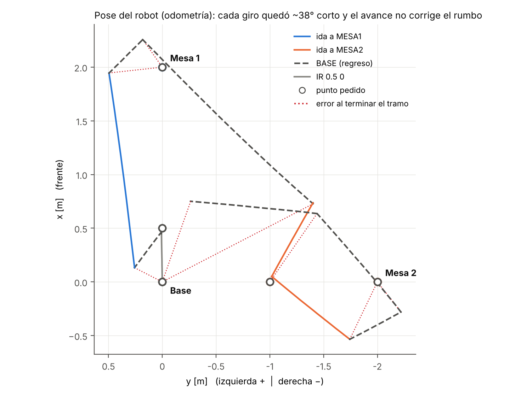
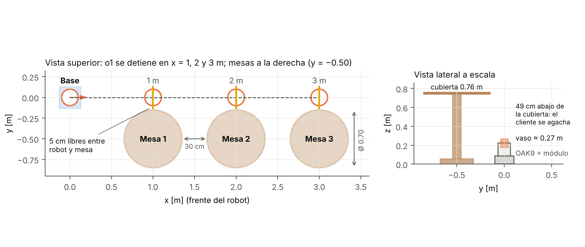

# Movimiento y calibración

## Datos del robot

| Dato | Valor | Fuente |
|---|---|---|
| Radio de rueda ρ | 0.034 m | Modelo cinemático del equipo |
| Separación entre ruedas L | 0.1663 m | Modelo cinemático del equipo |
| CPR del encoder | 905 | Calibrado el 6 oct 2026 |
| Diámetro del robot | 200 mm | CAD |
| Punto de referencia | o1, el centro entre las ruedas | — |

Cinemática diferencial: v = ρ(ωR + ωL)/2 y ω = ρ(ωR − ωL)/L. Rueda derecha positiva e izquierda negativa = giro antihorario (θ crece).

El firmware del OAK9 calcula la pose (`pose.get`, en mm y grados) con los encoders y el giroscopio. Las velocidades de rueda se mandan con `wheel_velocity`, en grados por segundo de rueda.

## Por qué no usamos `go2point` del firmware

Prueba del 2 nov 2026 con `go2point`. Las rutas eran las anteriores, con giros:



- **Giros:** cada uno terminó **~38° antes** de lo pedido.
- **Avances:** cada uno terminó **~5 cm antes** de lo pedido.
- **Rumbo:** al avanzar no corrige el rumbo, así que el error de cada giro se arrastra al siguiente tramo.
- **Causa:** el firmware termina cada fase por perfil de tiempo, no por la pose medida.

**Decisión:** controlar el movimiento desde la computadora con un **lazo cerrado sobre la pose medida**.

## El navegador de lazo cerrado (`robocoffe_fsm/movimiento.py`)

`NavegadorPC` es **el mismo** en el robot real (`robot_oak9.py`) y en Webots (`robot_webots.py`). No bloquea: la máquina de estados lo llama una vez por ciclo, a 20 Hz, con la pose recién leída, y él regresa las velocidades de rueda.

Cada tramo `IR(x, y)` tiene dos fases. `GIRAR(th)` usa solo la primera.

1. **GIRO hacia el punto (o al rumbo pedido)**
   - Velocidad de giro proporcional al error, `k_th = 2`.
   - Velocidad mínima de rueda: 45 °/s. Por debajo de eso la rueda no se mueve (zona muerta).
   - Velocidad máxima de rueda: 150 °/s.
   - Termina cuando el error es menor a 2° o cuando el error **cambia de signo**. Esa segunda condición evita que el robot oscile alrededor del rumbo por la zona muerta.
2. **AVANCE**
   - Velocidad `v = min(k_d·distancia, v_avance, rampa)`, con una rampa de 0.10 m/s².
   - Corrige el rumbo hacia el punto mientras avanza (`k_rumbo = 2`). La corrección está limitada al 50 % de la velocidad base.
   - Velocidad mínima de rueda: 30 °/s.
   - Termina cuando falta menos de 1 cm **en la dirección de avance**. Si ya se pasó, también termina; no regresa.
   - Si el rumbo se desvía más de 30°, vuelve a la fase de giro.

**Protección contra el WiFi:** si entre dos lecturas pasan más de 0.5 s, las ruedas se ponen en cero hasta que llegue una lectura fresca. Así el robot nunca avanza a ciegas.

La máquina revisa la llegada con su propia tolerancia (`tol_pos = 3 cm`, `tol_th = 3°`), más amplia que la del navegador (1 cm, 2°). Si queda fuera, reintenta el tramo hasta 2 veces.

| Parámetro | Valor | Nota |
|---|---|---|
| `v_avance` | 0.10 m/s | Empezar lento; luego probar 0.15 |
| `w_min_recta` | 30 °/s de rueda | El log del 19 oct marca ~25 |
| `w_min_giro` | 45 °/s de rueda | A 30 no giraba. `<POR MEDIR>`: `GIRAR 90` en `probar_movimiento.py`, subiendo de 5 en 5 hasta que termine limpio |

La zona muerta en línea recta se mide con `real/prueba_zona_muerta.py`. Antes de correrlo hay que editar `HOST`.
| `tol_pos` / `tol_th` | 1 cm / 2° | Paro del navegador |

## Resultados

| Prueba | Resultado |
|---|---|
| Webots R2025a, tres mesas seguidas | Error real de −9 mm en las 3 mesas y de +9 a +10 mm en la base; rumbo final +0.9°; 177.5 s |
| Webots con zona muerta de 30 °/s | Igual: −9 mm; 177.7 s |
| Webots con regreso en reversa | −9 mm; rumbo final 0.0°; 153.4 s |
| Robot real, 12 nov, `probar_movimiento.py` a MESA2 | Llegó. y dentro de ±2 mm en la recta y rumbo de −180.3° tras el giro. El único problema fueron los cortes de WiFi; ya se manejan |
| Robot real, error de llegada en el piso con medición externa | `<POR MEDIR>` |

El error de ~9 mm es el paro del navegador a 1 cm del punto. Webots no modela el WiFi, el derrape ni la zona muerta real, así que en el piso real el error va a ser mayor.

## Disposición de las mesas (12 nov 2026)



- **Base:** o1 en (0, 0), mirando a +x.
- **Puntos de entrega:** o1 en x = 1, 2 y 3 m, con y = 0.
- **Mesas:** a la derecha del pasillo, con centro en y = −0.50 m.

Distancia real de la estación a cada mesa, medida con cinta: `<POR MEDIR>`. Se corrige en `rutas.py` (`D_MESAS`) y en `registro_pruebas.py` (`DISTANCIA_M`).

## Cómo calibrar o revisar el movimiento

Se usa `probar_movimiento.py`, que no usa máquina de estados ni plataforma:

```bash
python probar_movimiento.py 192.168.1.173      # IP del robot
oak9> IR 0.5 0          # primera prueba corta
oak9> BASE
oak9> MESA1
oak9> BASE
```

- **Durante el movimiento:** muestra la pose en vivo.
- **Al terminar cada tramo:** muestra el error.
- **Registro:** guarda todo en `movimiento_<fecha>.csv`.
- **Paro:** Ctrl+C detiene el robot de inmediato.

Qué ajustar según lo que se vea:

| Síntoma | Ajuste |
|---|---|
| Gira y no termina, oscila | Subir `W_MIN_GIRO` de 5 en 5 |
| No arranca en línea recta | Subir `W_MIN_RECTA` |
| Se pasa del punto | Bajar `V_AVANCE` o `K_D` |
| Se desvía de lado al avanzar | Subir `K_RUMBO` (no más de 4) |
| Se queda corto siempre por lo mismo | Revisar ρ y el CPR (odometría), no el controlador |

Los mismos valores están en `NavegadorPC(...)`. Si se cambian en `probar_movimiento.py`, hay que copiarlos a `robocoffe_fsm/movimiento.py`.
